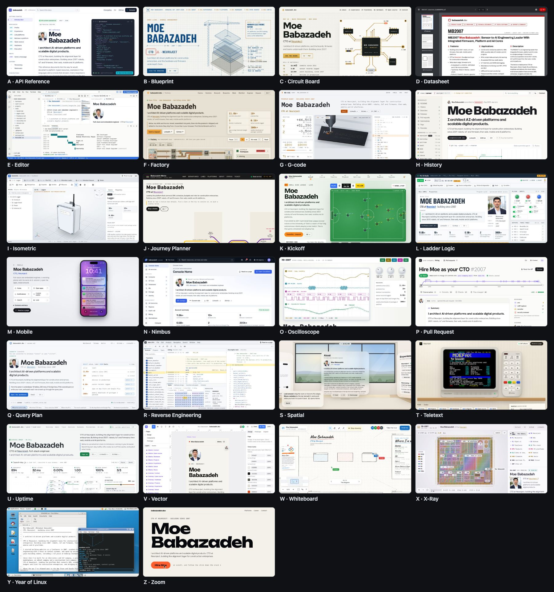

# babazadeh.dev

The personal site of **Moe Babazadeh**, CTO at Neuroject: one career, told through 26 themes. Each theme is the whole site, built as a different working tool: an API reference, an oscilloscope, a pull request, a Linux desktop with a desktop cube, a RoboCup simulator, a reverse-engineering suite, and more.

**[babazadeh.dev](https://babazadeh.dev)** opens one of the favourites at random. Use the switcher in the bottom-right corner to move between themes, or browse them all in the **[gallery](https://babazadeh.dev/concepts)**.



## The themes

|                                                                   |                                                                               |                                                                   |                                                                 |
| ----------------------------------------------------------------- | ----------------------------------------------------------------------------- | ----------------------------------------------------------------- | --------------------------------------------------------------- |
| A · [API Reference](https://babazadeh.dev/concepts/api-reference) | B · [Blueprint](https://babazadeh.dev/concepts/blueprint)                     | C · [Circuit Board](https://babazadeh.dev/concepts/circuit-board) | D · [Datasheet](https://babazadeh.dev/concepts/datasheet)       |
| E · [Editor](https://babazadeh.dev/concepts/editor)               | F · [Factory](https://babazadeh.dev/concepts/factory)                         | G · [G-code](https://babazadeh.dev/concepts/g-code)               | H · [History](https://babazadeh.dev/concepts/history)           |
| I · [Isometric](https://babazadeh.dev/concepts/isometric)         | J · [Journey Planner](https://babazadeh.dev/concepts/journey-planner)         | K · [Kickoff](https://babazadeh.dev/concepts/kickoff)             | L · [Ladder Logic](https://babazadeh.dev/concepts/ladder-logic) |
| M · [Mobile](https://babazadeh.dev/concepts/mobile)               | N · [Nimbus](https://babazadeh.dev/concepts/nimbus)                           | O · [Oscilloscope](https://babazadeh.dev/concepts/oscilloscope)   | P · [Pull Request](https://babazadeh.dev/concepts/pull-request) |
| Q · [Query Plan](https://babazadeh.dev/concepts/query-plan)       | R · [Reverse Engineering](https://babazadeh.dev/concepts/reverse-engineering) | S · [Spatial](https://babazadeh.dev/concepts/spatial)             | T · [Teletext](https://babazadeh.dev/concepts/teletext)         |
| U · [Uptime](https://babazadeh.dev/concepts/uptime)               | V · [Vector](https://babazadeh.dev/concepts/vector)                           | W · [Whiteboard](https://babazadeh.dev/concepts/whiteboard)       | X · [X-Ray](https://babazadeh.dev/concepts/x-ray)               |
| Y · [Year of Linux](https://babazadeh.dev/concepts/year-of-linux) | Z · [Zoom](https://babazadeh.dev/concepts/zoom)                               |                                                                   |                                                                 |

Nineteen earlier designs live on in the gallery's **Bonus** section. The original single-page site is still at [/classic](https://babazadeh.dev/classic).

## How it works

- **One source of facts.** Every date, figure, role and link lives in [`src/content/db.ts`](src/content/db.ts). Each theme reads from it, so a change made there shows up everywhere. An ESLint rule fails the build if a fact is typed straight into a theme.
- **Real tools, not mock-ups.** The themes run on real mechanisms: a formula engine with dependency tracking, a small Python interpreter, a Thumb-2 assembler and disassembler, packet and protocol decoders, a PID-controlled plant, robot and physics simulations.
- **One registry.** [`_shared/concepts.ts`](<src/app/(concepts)/concepts/_shared/concepts.ts>) lists every theme. It drives the switcher, the gallery, the random start and the bonus section.
- **Light and dark everywhere.** The scheme follows the system unless the visitor picks one, and it's applied before the first paint, so pages don't flash.
- **Shareable.** Every theme has its own address, title, description and share image.

## Built with

[Next.js 16](https://nextjs.org) (App Router, with the Pages Router for the classic site) · React 19 · TypeScript · Sass modules · [three.js](https://threejs.org) for the 3D themes · fonts from Google Fonts, self-hosted by `next/font` · hosted on [Vercel](https://vercel.com).

## Running it locally

You need Node.js 24 (see [`.nvmrc`](.nvmrc)) and pnpm (the version is pinned in `package.json`).

```sh
pnpm install
pnpm dev        # http://localhost:3000
```

| Command          | What it does                                |
| ---------------- | ------------------------------------------- |
| `pnpm dev`       | Start the development server                |
| `pnpm lint`      | ESLint, including the facts rule            |
| `pnpm typecheck` | Generate Next.js types, then run TypeScript |
| `pnpm build`     | Production build                            |

No environment variables are required. [`.env.example`](.env.example) lists the one optional setting.

## Project structure

```text
src/
├── app/
│   ├── (concepts)/
│   │   ├── route.ts            / → a random favourite, or the visitor's pinned theme
│   │   ├── layout.tsx          fonts, light and dark, the switcher
│   │   └── concepts/
│   │       ├── page.tsx        the gallery (/concepts)
│   │       ├── _shared/        registry, switcher, facts, hooks, metadata
│   │       └── <theme>/        one folder per theme
│   ├── sitemap.ts
│   └── robots.ts
├── content/
│   ├── db.ts                   every fact, in one place
│   └── format.ts               dates, figures and lists
└── pages/                      the classic site (/classic, /archive)
public/
├── og/                         a share image for every theme
└── resume.pdf
```

## Credits

The classic site at `/classic` and `/archive` is based on [Brittany Chiang's v4](https://github.com/bchiang7/v4) design ([brittanychiang.com](https://brittanychiang.com)). The credit for that design is hers.

## Licence

© Moe Babazadeh. All rights reserved. You're welcome to read the code, learn from it, and fork it to see how it works. If you reuse any part of it, credit me with a visible link to [babazadeh.dev](https://babazadeh.dev) and this repository. Please don't republish the site, its design or its personal content as your own. The full terms are in [LICENSE](LICENSE).
